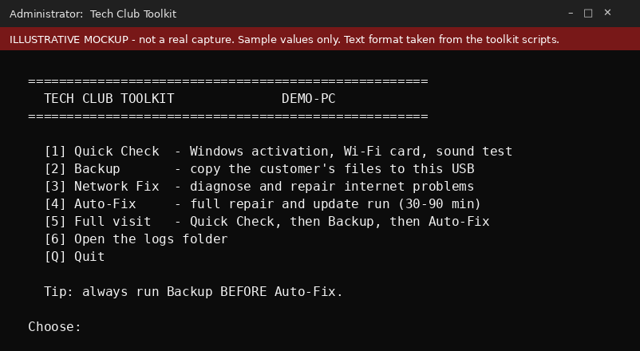
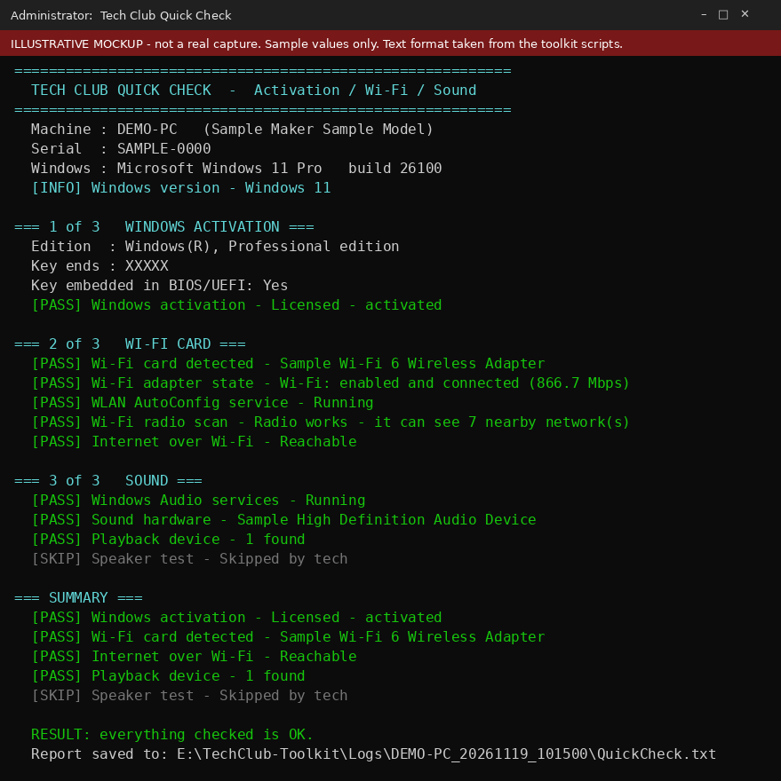
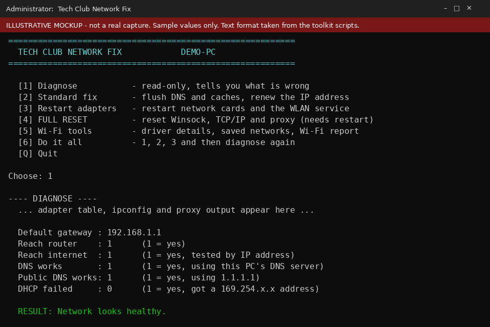
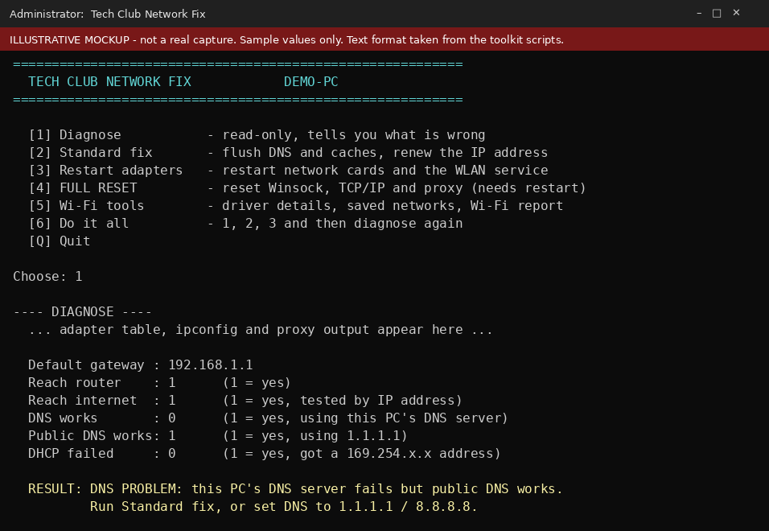
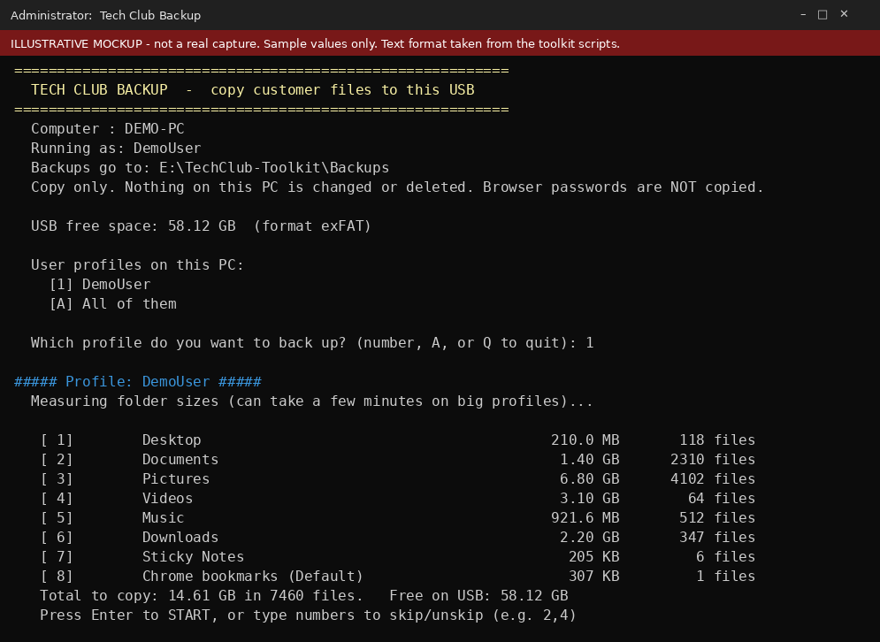

# Screenshots

Visual reference for what the TechClub Toolkit looks like when it runs, so you know what "normal" looks like before you are standing at a customer's PC.

There are two kinds of image here. **They are kept apart on purpose** so a mockup is never mistaken for a real run.

| Folder | What it contains | Status |
|---|---|---|
| [`real/`](real/) | Screenshots captured from actual runs of the toolkit | Add yours here (see the capture guide below) |
| [`mockups/`](mockups/) | Images rendered from the scripts' own menu text and output format, with sample values | Illustrative only. Every image carries a red "ILLUSTRATIVE MOCKUP" banner |

## Mockups

| Image | Shows |
|---|---|
|  | **Main menu.** `TechClub_Toolkit.bat`, the launcher. Menu text is copied from the script |
|  | **Quick Check.** Activation, Wi-Fi card and sound, each with PASS / WARN / FAIL / SKIP and a final RESULT line |
|  | **Network Fix, Diagnose (healthy).** The router, internet, DNS and DHCP checks, ending in a verdict |
|  | **Network Fix, Diagnose (DNS problem).** What a failing result looks like and the advice it gives |
|  | **Backup, selection screen.** Profiles, per-folder sizes, total against free USB space. Nothing has been copied yet at this point |

What is real and what is made up in the mockups:

- **Real:** the wording, layout, column format, and the PASS / WARN / FAIL labels, taken from the scripts.
- **Made up:** every value. The PC name (`DEMO-PC`), user (`DemoUser`), serial number, key, drive letter, sizes, file counts, network count, and speed are samples.

The mockups are generated by a script, not captured, so they show the format but **do not prove the tools work on any particular PC**. Use `real/` for that.

## Capture guide: real screenshots

Take these on a Windows 11 PC you own or have permission to work on.

1. Run `TechClub_Toolkit.bat` from the USB and approve the admin prompt.
2. Capture the screens that change nothing:
   - **Main menu** (the first screen)
   - **Quick Check** (menu option 1). Say `n` when it offers the speaker test if you want a quiet run
   - **Network Fix > Diagnose** (menu option 3, then 1)
   - **Backup selection screen** (menu option 2, choose a profile). **Stop at the "Press Enter to START" line and quit**, or the backup will run
3. Use **Win+Shift+S** and drag over the window, then save from the notification or paste into Paint.
4. Name files to match the mockups, for example `01_main_menu.png`, so the two folders line up.

### Before you commit a real screenshot

Real runs contain details you probably should not publish. Check each image, and blur or crop:

| Where it appears | What to hide |
|---|---|
| Menu and Network Fix headers | The computer name, if it identifies you or a customer |
| Quick Check header | **Serial number**, and the "Key ends" characters |
| Quick Check and Network Fix | Wi-Fi network names, IP addresses, MAC addresses |
| Backup | The username and any folder names that show personal or customer files |
| Anywhere | Customer names, email addresses, file names |

Do not commit anything from a customer's PC without their permission. Logs and backups are git-ignored for the same reason (see the toolkit's `.gitignore`).

To blur in Windows, Paint's selection tool can fill a rectangle with a solid colour. A solid block is safer than a light blur.
